<div align="center">
  
  <h1>DSH Todos</h1>
  <p><strong>理清待办，把今天交给专注。</strong></p>
  <p>DeepSeek Harness 的待办与专注插件。<br>从清单、四象限，到 Three.js 心流轨道与番茄钟，让计划自然进入行动。</p>
  <p>
    <a href="LICENSE"></a>
    
    
  </p>
  <p>
    <a href="#今天的动画">今天的动画</a> ·
    <a href="#番茄钟">番茄钟</a> ·
    <a href="#安装">安装</a> ·
    <a href="#功能一览">功能</a> ·
    <a href="#开发与验收">开发与验收</a>
  </p>
</div>

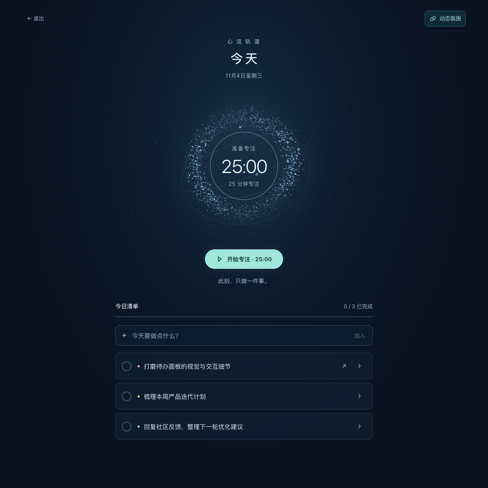

| 整理工作 | 进入专注 | 回到现场 |
| --- | --- | --- |
| 清单、优先级、标签与四象限，把事情安排清楚。 | 今日清单与 25 / 5 番茄钟，一次处理一件事。 | 任务关联 DSH 会话，与智能体共用同一份清单。 |

> 以下截图和动图均来自本地浏览器中的真实插件界面，使用演示数据。番茄钟阶段切换演示缩短了等待时间，产品时长仍为 **25 分钟专注 / 5 分钟休息**。

## 今天的动画

### 心流轨道

进入今天，粒子环与三条星轨围绕计时器缓慢流动。专注时粒子收拢为青绿色，休息时转为暖金色；暂停会定格场景，勾选完成任务会扩散一圈微光。

<p align="center">
  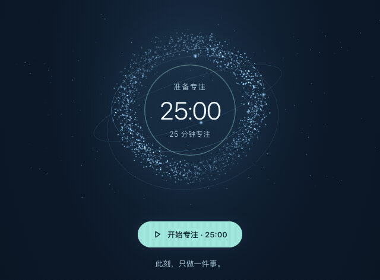
</p>

### 从输入到行动

| 聚焦流光 | 新增微光 |
| --- | --- |
| 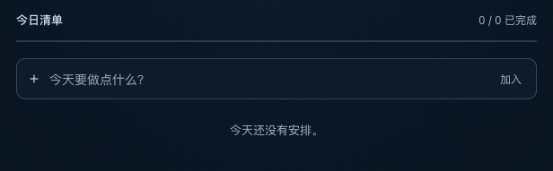 | 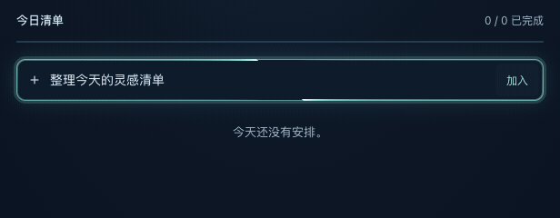 |
| 聚焦时展开光晕，双流光沿边框游走；失焦后淡出。 | 新增成功后，新卡片滑入、扫过微光，再渐渐回到普通状态。 |

连续添加会分别反馈，同名任务也能正确识别。请求失败会保留草稿，等待期间输入的下一条内容也不会被清空。

右上角的 **动态 / 静态氛围** 开关会记住偏好；系统开启「减少动态」时，保留静态聚焦和新增高亮。动画装饰不拦截点击，任务与计时器始终由可访问的 HTML 控件承载。无 WebGL 时显示静态轨道。

## 番茄钟

**先选任务 → 专注 25 分钟 → 确认进展 → 休息或继续。** 在「本轮专注任务」中明确选择一项今日未完成任务，再开始专注。计时器绑定任务 ID，清单排序、改名或其他任务完成都不会悄悄换掉本轮目标。

时间到了或主动结束时，先查看本轮小结：可以「完成任务并休息」、继续同一任务、休息 5 分钟，或结束本轮另选任务。遇到阻碍可暂停计时，写下阻碍和下一步，继续时保留剩余时间。任务不会仅因为时间到而自动完成；完成操作保存失败时保留小结和备注，不会进入假成功的休息状态。

原任务被删除或完成时，会暂停专注并说明原因，不会切到别的任务。阻碍备注只保存在当前浏览器的这一轮专注中，刷新可恢复，结束本轮后清除，不是永久任务备注。

下方动图展示旧版计时器的视觉效果；新版结束后先显示小结，由你决定是否休息。

| 开始、暂停、继续与结束 | 专注结束，进入休息 |
| --- | --- |
| 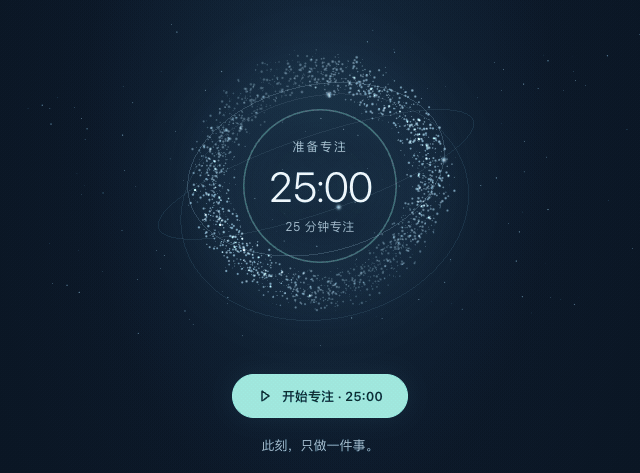 | 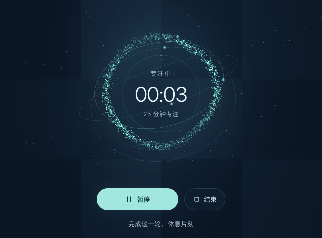 |
| 暂停同时定格倒计时与轨道，继续时接着剩余时间运行。 | 倒计时归零后先显示小结，选择休息后颜色与状态文字同步变化。 |

| 状态 | 时钟行为 | 视觉反馈 |
| --- | --- | --- |
| 准备 | 显示 `25:00`，等待开始 | 蓝色星轨缓慢流动 |
| 专注 | 按截止时间递减 | 青绿色粒子收拢，进度环随时间变化 |
| 暂停 | 保存剩余时间 | 场景静止，显示「已暂停」 |
| 小结 | 停止计时，确认完成、继续或遇到的阻碍 | 显示本轮任务和后续操作 |
| 休息 | 明确选择后开始 5 分钟倒计时 | 轨道与进度环转为暖金色 |
| 结束本轮 | 清除本轮计时和备注，返回任务选择 | 显示开始按钮；全部任务完成时保留完成氛围 |

计时依据绝对截止时间，离开「今天」或动画停止不会让时钟变慢。运行、暂停和小结状态可在刷新、重新打开面板后恢复；已经到期的记录会恢复为待确认小结。计时器与动态偏好保存在浏览器中，清理浏览器存储会重置它们。

<details>
<summary><strong>更多界面：静态专注 / 休息、浅深主题、四象限与窄屏</strong></summary>

### 专注与休息 · 静态截图

| 专注 | 休息 |
| --- | --- |
| 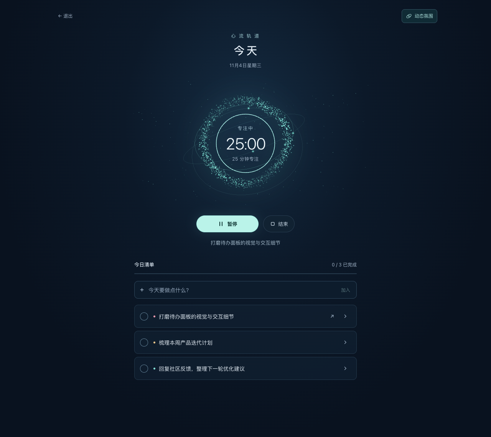 | 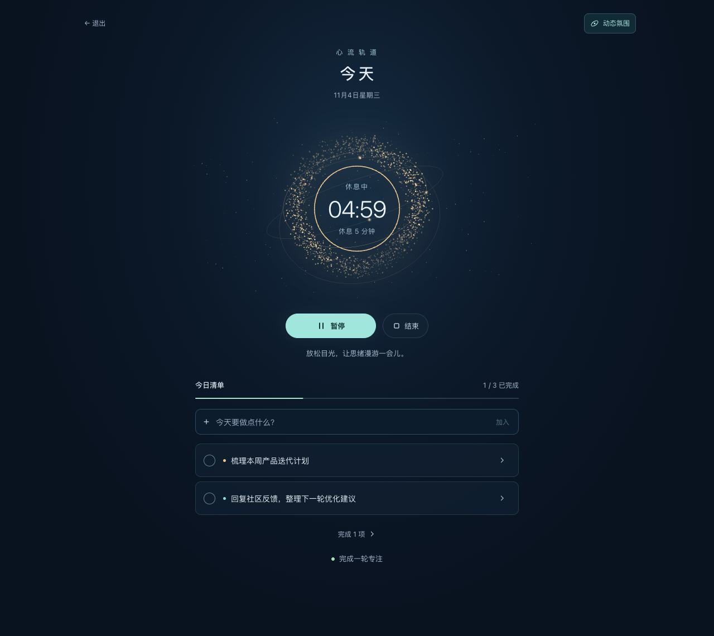 |

### 清单 · 跟随宿主主题

| 浅色 | 深色 |
| --- | --- |
| 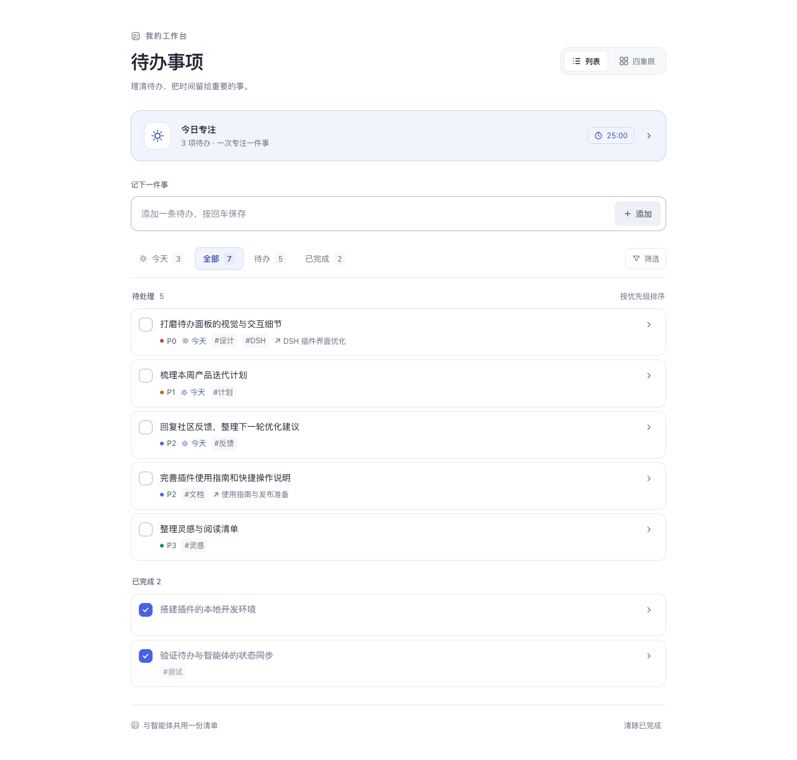 | 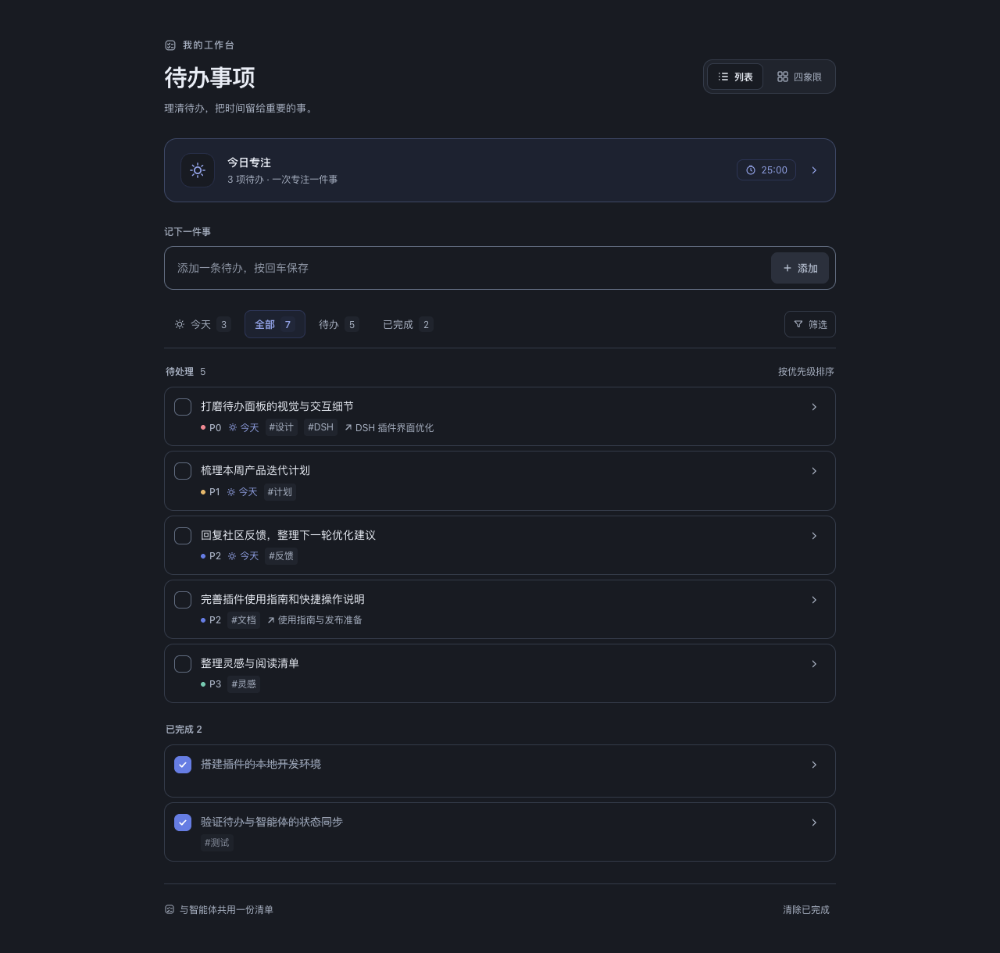 |

### 四象限 · 区分重要与紧急

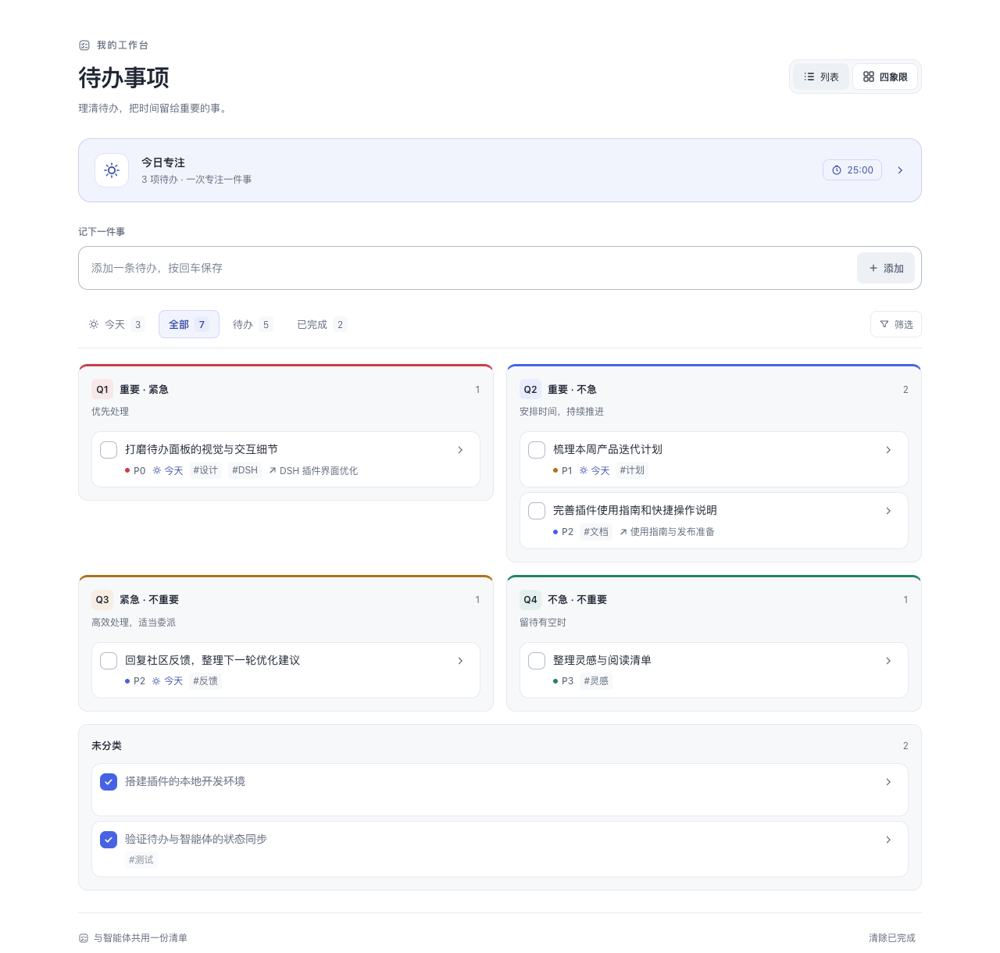

### 窄屏 · 保留完整操作

375px 英文界面，系统「减少动态」生效后的静态场景。

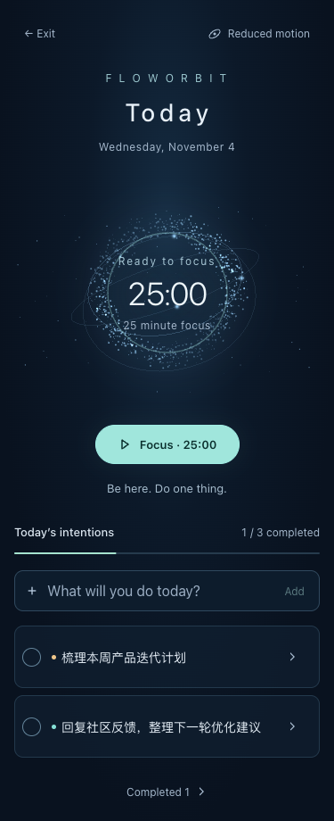

</details>

## 安装

需要 DeepSeek Harness；Host 的 Node.js 版本要求为 20 或更高。插件安装到指定 **profile**：桌面端通常使用 `desktop`，浏览器构建通常使用 `web`。

### 推荐：从本地源码安装

```bash
git clone git@github.com:kaelinda/dsh-today-todo.git
```

在 DSH 中打开 **插件 → 添加插件 → 从本地目录安装**，选择刚克隆的目录；也可以使用 CLI：

```bash
dsh plugin --profile desktop add /absolute/path/to/dsh-today-todo
```

CLI 安装后重启 Host。也可在会话中调用 `plugin_manager` 的 `install_bundle`，传入本地绝对路径。

仓库提交了构建后的 `client.js`，Three.js 已包含在其中。**安装无需运行构建，也不依赖 CDN 下载界面资源。**

<details>
<summary>可选：使用 Git 地址安装</summary>

pnpm 支持 Git spec，可尝试：

```bash
dsh plugin --profile desktop add git+ssh://git@github.com/kaelinda/dsh-today-todo.git
```

若当前桌面端不接受 Git spec，请使用上面的本地安装方式。本包设置了 `private: true`，不发布到 npm。

</details>

## 功能一览

| 能力 | 使用方式 |
| --- | --- |
| 待办管理 | 新增、重命名、完成、删除、筛选及清除已完成；支持回车保存与中文输入法选词保护。 |
| 优先级与标签 | `P0`–`P3` 或不分级；标签可编辑，点击行内标签即可筛选。 |
| 四象限 | 按重要性、紧急性分组，保留未分类区域；颜色、文字与 Q1–Q4 标识共同区分。 |
| 今日清单 | 在详情中「加入今天」，或直接进入今天新增；按优先级、同级创建时间新到旧排序。 |
| 任务详情 | 点击标题或行尾箭头展开；键盘与触屏均可访问重命名、删除等操作。 |
| 会话关联 | 任务关联 DSH 会话，一键回到上下文；归档或不可用会话会显示提示。 |
| 智能体协作 | `todo_track` 提供 `list / add / update / remove / clearDone`，与面板使用同一个存储入口；列表支持分页和过滤。 |
| 中英与主题 | 中英文文案；列表和四象限跟随宿主主题，今天使用独立夜色配色。 |

「今天」由 **Host 的本地日期**决定。跨日后，旧任务仍在「全部」中保留；需要继续处理的任务可重新加入今天。

## 数据与偏好

| 内容 | 保存位置 | 行为 |
| --- | --- | --- |
| 待办、标签、优先级、会话关联 | Host 文件 | 独立于浏览器存储，支持自定义路径。 |
| 番茄钟状态 | 浏览器 `localStorage` | 恢复有效计时；清理浏览器存储后重置。 |
| 动态开关偏好 | 浏览器 `localStorage` | 刷新后保留，并服从系统「减少动态」设置。 |

待办默认保存在 `$DSH_HOME/dsh-todos/todos.json`，可通过 `DSH_TODOS_FILE` 或 `dataFile` 配置路径。

Host 使用文件锁与原子写入来协调多端修改；面板遇到 revision 冲突时采用新快照重试。损坏的文档会先备份，再降级为空清单。配置示例、字段限制与恢复机制见[开发与数据参考](docs/development.md)。

## 开发与验收

```bash
npm ci          # 安装锁定的开发依赖
npm run build   # 从 src/client 生成 client.js
npm test        # 先构建，再运行 Node 测试
```

修改 `src/client/` 后再构建，**不要直接编辑 `client.js`**。开发依赖仅包含固定版本的 Three.js 和 esbuild；测试会检查产物与源码是否一致。

本次基于功能提交 `8f6f1fb` 完成：

- **38 项自动测试通过**：覆盖生成产物、存储并发、接口、工具分页、动效调度和新增反馈边界。
- **22 项浏览器验收通过**：覆盖今天页交互、计时全流程、刷新恢复、动态偏好、WebGL 降级与资源清理，以及窄屏英文布局。
- **2 次 axe 检查未发现违规项**：桌面今天页及 375px 英文详情。

[查看完整验收报告](docs/qa/2026-11-04-today-acceptance.md) · [开发与数据参考](docs/development.md) · [更新记录](CHANGELOG.md)

验收使用隔离演示数据与本地浏览器预览；阶段到期通过缩短测试截止时间验证。本轮未进行真实 DSH Host 安装验收，也未实际等待完整的 30 分钟。

## License

[MIT](LICENSE) © 2026 kaelinda · [第三方许可](THIRD_PARTY_NOTICES.md)
