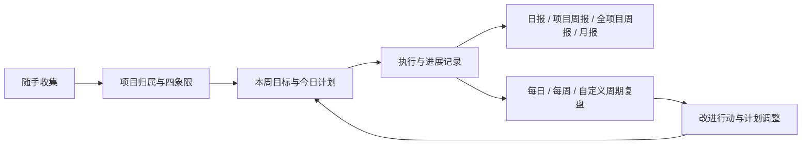

# DSH Todos 升级规划：个人工作台

> 状态：已 review，2.0 本地实现与自测完成。日期：2026-11-10。规划代码基线：`main @ dd407aaaab6658372e4b8f4dbde57eba5fd19b55`。实际实现说明见[个人工作台说明](workbench.md)，验证边界见[验收记录](qa/2026-11-10-workbench-acceptance.md)。
> 本方案基于当前代码、项目文档和本机 Harness 能力检查；工作量是初步估计，不是交付承诺。

## 1. 产品目标与推荐方向

把 DSH Todos 升级为一个帮助自己安排工作、记录进展、生成报告和持续改进的个人工作台。每天打开时，能知道今天最值得推进什么；周期结束时，能根据已有记录完成报告和复盘，并把调整带入下一周期。

**产品闭环：收集 → 判断重要与紧急 → 安排工作 → 记录进展 → 生成报告 / 复盘 → 调整下一周期。**

继续使用现有插件包、面板和任务记录。展示名称可以逐步改为「个人工作台」，技术包名 `dsh-todos` 暂时保留，避免让产品定位调整变成安装和兼容性改造。

本轮需求证据来自你的实际描述：任务多且轻重缓急不同；报告有不同周期和项目范围；希望规划与复盘能帮助改善工作。尚无使用数据，后文的默认参数与效果目标都需要通过真实使用校准。

### 推荐默认值

| 项目 | 初始建议 | 可调整方式 |
| --- | --- | --- |
| 自动化程度 | 到点生成草稿，由自己查看和修改 | 每条规则可选仅提醒、生成草稿、暂停 |
| 数据范围 | 手工记录、任务事件、主动添加的产出与进展 | 后续再接入外部工作来源 |
| 项目归属 | 每个任务一个主项目，也允许暂未归属 | 通用标签可多个 |
| 周起始日与时区 | 初始读取 Host 设置，首次设置明确显示 | 保存为用户设置；之后不随浏览器时区漂移 |
| 今日计划 | 建议 1–3 个重点，并预留缓冲 | 重点数量与缓冲比例可调整 |
| 报告与复盘 | 分别配置范围、周期和模板 | 可以同一时间运行，也可以独立运行 |

外部自动发送、多用户协作、复杂项目依赖图、日历双向同步放在后续扩展；第一轮优先形成自己每天可用的闭环。

## 2. 当前基础与实际缺口

| 领域 | 当前已实现 | 本轮应补齐 |
| --- | --- | --- |
| 任务管理 | 标题、完成状态、P0–P3、自由标签、会话关联 | 项目、状态细分、截止日、计划日、估时、进展与产出 |
| 四象限 | Q1–Q4 与未分类区域，手动归类 | 分类依据、临期提醒、每个象限对应的后续动作 |
| 今日清单 | 加入今天、今日筛选、按优先级排序 | 今日重点、容量、每日计划快照、未完成任务重排 |
| 专注 | 25/5 番茄钟、浏览器恢复与动态效果 | 关联 taskId 的专注记录、暂停扣除、跨日统计 |
| 项目 | 现有字符串标签可作筛选 | 稳定项目身份、项目目标、独立报告与复盘规则 |
| 报告与复盘 | 尚未实现 | 统一事实查询、模板、草稿编辑、历史版本、周期规则 |
| 持久化 | JSON v2、revision、文件锁、原子写入 | 状态与历史原子保存、明确落盘结果、迁移与恢复 |

必须先解决的三个数据问题：

1. 只有 `done` 和 `updatedAt`，没有完成事件。重命名也会更新 `updatedAt`，因此不能把它作为完成时间生成周报。
2. `remove / clearDone` 会物理删除任务；「加入今天」会覆盖旧日期。历史完成、延期和每日承诺会丢失。
3. `commit()` 当前没有根据 `persist()` 的失败结果返回失败。报告和复盘上线前，必须让面板、工具和调度器明确知道内容是否落盘。

其他限制：当前 500 条上限包含已完成任务；番茄钟仅保存浏览器中的当前状态和任务标题，不是累计工时日志。旧数据已缺失的历史无法自动还原，只能标注未知或允许用户补记。

代码依据：[`lib/store.js`](../lib/store.js) 的 `normalizeStoredItem / commit / update / remove / clearDone`；[`src/client/page.js`](../src/client/page.js) 的 `accept` 与番茄钟状态；[`src/client/pomodoro.js`](../src/client/pomodoro.js)；[`lib/tool.js`](../lib/tool.js)。当前目录职责见[开发文档](development.md)。

## 3. 任务跟踪：让四象限产生具体安排

### 3.1 快速收集与任务详情

新增任务时只必填标题，允许先进入收集箱。整理时再逐步补充：主项目、下一步行动、象限、截止时间、预计投入和计划日期。收集箱包含尚未明确下一步或尚未分类的任务，避免随手记一件事就要填写完整表单。

任务状态建议采用「待处理 / 进行中 / 等待中 / 已完成 / 已取消」。归档是可见性状态，不代替完成状态；等待中可填写等待对象、原因和下次跟进日。

完成时允许补一句“实际产出了什么”，并附文档、提交或会话链接；不强制每件小事写总结。未完成的大任务也可随时记录进展、决策和阻塞，让周报能体现持续推进的工作。

### 3.2 四象限与执行顺序

| 象限 | 判断问题 | 默认动作 |
| --- | --- | --- |
| Q1：重要且紧急 | 延迟会造成明显损失，且时间窗口很近吗？ | 加入近期计划；超出容量时明确取舍或协商截止日 |
| Q2：重要不紧急 | 对目标有价值，但短期没有强制时限吗？ | 安排具体日期或时间盒，保护长期工作投入 |
| Q3：紧急不重要 | 需要及时响应，但不一定需要自己完成吗？ | 批量处理、沟通或委派；需要跟进时进入等待中 |
| Q4：不重要不紧急 | 现在是否值得投入？ | 暂存、取消或归档 |

四象限保留为任务的明确分类，P0–P3 作为可选的执行排序，不强行一一映射。截止日用于提示时间压力；“快到期”不会自动等于“重要”。第一版可以建议调整象限，并展示依据，由用户接受后修改。

### 3.3 今日与本周规划

本周先写 1–3 个希望达成的结果，再选择支持它们的任务。今天页保留现有专注区，增加“今日重点、预计投入 / 可用时间、待重排”三个轻量区域，详细分析放到规划页。

- 可用时间由用户设置，扣除会议和固定事务；第一版不依赖日历接入。
- 例如今日可用 6 小时、缓冲 30%，建议安排约 4.2 小时。比例只是起始参数，可以修改。
- 没有估时的任务显示“待估”，不按零小时处理；超载提示同时展示未估时任务数量。
- 一次专注一个任务；可设置同时进行中任务的建议上限，减少切换。
- 未完成的今日任务次日进入“待重排”，选择继续、改期、拆分或取消，避免无限自动滚动。
- 保存每日计划的初始承诺、临时新增和后续调整，复盘时能区分原计划与插入工作。

## 4. 项目与标签：支持独立周报，也能汇总全局

界面继续以易操作的“项目标签”呈现，底层增加稳定的 `Project` 实体。项目名称可以修改，配置和历史引用使用项目 ID。

| 对象 | 例子 | 职责 |
| --- | --- | --- |
| 主项目 | 项目 A、项目 B、个人学习 | 工作归属、项目目标、独立报告与复盘设置 |
| 通用标签 | 开发、沟通、写作、家庭 | 跨项目筛选与工作类型分析 |
| 项目目标 | 本月完成首个可用版本 | 明确期望结果与验证标准 |

旧标签不自动全部变成项目；提供映射界面，选择哪些标签提升为项目。同一旧任务命中多个项目标签时选择一个主项目，其他标签保留，避免悄悄重复统计。

项目页包含：目标与完成标准、任务与四象限、本期进展、产出、阻塞、报告规则、复盘规则和历史记录。一个项目可以每周生成周报，另一个项目只生成月报，也可以加入某个多项目联合周报。

报告范围支持：**单项目 / 选定的多个项目 / 所有项目**，以及可选通用标签筛选。未归属活动在全局报告中单列；归档项目在所选周期发生过活动，仍应被纳入。

跨项目汇总从原始事件和工作记录聚合，按任务 / 事件 ID 去重，不把各项目周报直接相加。第一版工时归属于记录发生时的主项目；移动任务不会改写已经发生的投入归属或已定稿报告。

历史报告的通用标签筛选同样使用事件发生时的标签快照。若希望用现在的分类重新分析过去，提供显式的“按当前分类重新统计”，生成独立修订，并标明口径变化。

## 5. 报告：时间区间、项目范围和模板分别配置

### 5.1 报告类型与结构

所有报告共用“时间区间 + 范围 + 事实集合”，不用为日报、周报和月报各建一套数据系统。

| 类型 | 默认关注点 | 默认范围 |
| --- | --- | --- |
| 日报 | 今日推进、已完成产出、阻塞、下一步 | 所有项目，可缩小 |
| 项目周报 | 项目目标进展、关键成果、风险与依赖、下周安排 | 单项目或指定项目组 |
| 全项目周报 | 各项目进展、共同阻塞、投入分布、下周重点与取舍 | 所有项目，含未归属活动 |
| 月报 | 月度结果、目标差距、重要决策、跨周趋势、下月方向 | 所有项目或指定项目 |

报告的默认段落：**本期结果 → 关键进展 → 风险与待协助事项 → 下期计划**。完成任务列表可折叠作明细，不把勾选数量当作价值证明。

信息不足时显示“本期没有记录到活动”或“待补充”，可以补记进展。AI 不根据任务名称推断未记录的成果、上线状态或业务收益。会话链接只作为上下文入口，不默认扫描完整会话。

### 5.2 一份报告的生命周期

`准备事实 → 生成草稿 → 人工编辑 → 定稿 → Markdown 导出 / 复制`

每条生成结论在编辑器中可追溯到任务事件、工作记录或用户补充。导出的正文是否附明细可选，内部仍保存事实引用、生成时刻、覆盖区间和数据版本。

重新生成产生新修订，不覆盖人工修改或已定稿内容；事实之后发生变化时，提示可生成修订版。月报直接读取原始事实，已定稿周报可辅助表达，但不能通过重复拼接周报造成重复统计。

### 5.3 独立报告规则示例

以下时间均为示例，需要在启用时按实际习惯设置。

| 规则 | 范围 | 覆盖周期 | 生成时间 |
| --- | --- | --- | --- |
| 日报 | 所有项目 | 上一个自然日 | 每天 09:00 |
| 项目 A 周报 | 项目 A | 上一个自然周 | 每周一 09:00 |
| 项目 B + C 周报 | B、C | 上一个自然周 | 每周一 09:10 |
| 全项目周报 | 所有项目 | 上一个自然周 | 每周一 09:20 |
| 月报 | 所有项目 | 上一个自然月 | 每月 1 日 09:00 |

也支持周五提前生成“本周截至当前”的草稿，或晚上写当日日报。此时明确标注数据截止时刻；未结束周期的草稿不标为完整周期报告。

## 6. 复盘：形成下一轮可验证的改进

报告回答“推进了什么”，复盘回答“预期和实际为何不同，下次怎么调整”。两者共用事实，保留独立文档和可见范围；私人反思不自动进入工作报告。

定时生成复盘时，先准备事实、对照和待回答的问题，状态为“待复盘”。只有用户补充判断并确认后才算完成，不能用 AI 自动生成一段原因分析代替实际复盘。

### 6.1 每日复盘

默认 3–5 分钟，围绕三个问题：今天最有价值的推进是什么？什么打断或阻塞了原计划？明天最值得调整的一件事是什么？自动带出今日计划、临时新增、完成与进展，用户只补系统不知道的背景。

### 6.2 每周复盘

先检查上次的改进行动，再查看本周目标与实际结果、Q2 工作是否被挤占、重复延期和等待事项。最终选出 1–3 个改进行动，写明下一步、所属项目、检查日期和成功标准，纳入任务与下周计划。

例如：“本周三次被临时沟通打断”可以转为“下周试行每天两个集中答疑时段，周五检查中断次数和响应影响”。系统记录这是一次待验证的尝试，而不是认定已经找到了原因。

### 6.3 自定义周期

报告规则和复盘规则各自支持：每天、指定星期、每 N 天 / 周、每月指定日 / 月末、项目里程碑后手动触发。日历周期与“过去 N 天”的滚动窗口分别显示。

- 每 N 天从设置的锚点日期计算，不从上次实际运行时间继续偏移。
- 每月 29 / 30 / 31 日遇到短月时，默认取当月最后一天，并在设置中说明。
- 提供启用、暂停、跳过本次、稍后提醒与历史入口。跳过后保持原周期锚点。
- 新建规则预览接下来三次时间和覆盖区间，让配置效果可检查。
- 复盘不强制完成；遗漏后保留待处理记录，不累计大量弹窗。

## 7. 把思维模型放进具体操作

“科学规划”首先意味着目标明确、容量有限、事实可查、假设能修正。以下模型是辅助框架，不承诺使用后必然提高效率。

| 模型 | 放在哪个操作里 | 产生什么结果 |
| --- | --- | --- |
| GTD 的收集与下一步行动 | 快速收集后，整理时写清下一步 | 把模糊事项变成可执行任务，降低记录负担 |
| 艾森豪威尔四象限 | 任务分类与每周整理 | 对应立即做、安排、沟通 / 等待、暂存四类动作 |
| 时间盒与在制品限制 | 今日 / 本周计划 | 有估时、有缓冲、有并行上限的可执行安排 |
| PDCA | 周目标 → 执行记录 → 周复盘 → 改进行动 | 下一周期计划引用上一周期反馈 |
| AAR | 重要事件或项目阶段结束 | 记录预期、实际、差异原因假设、下一次调整 |

SMART 作为目标编辑提示即可，例如要求补上完成标准和检查日期；第一轮不用再增加独立的模型中心或完整 OKR 层级。

后续有足够历史再提供：同类任务估时参考、连续延期提示、投入与目标偏差、反复出现的阻塞。每条建议展示引用记录和样本量；缺数据时只提问题，不给看似精确的评分。

## 8. 界面与典型使用流程

保留一个插件入口，内部采用五个主区域：

| 区域 | 核心内容 |
| --- | --- |
| 今天 | 快速收集、今日重点、容量、专注、待重排、轻量复盘入口 |
| 任务 | 收集箱、清单、四象限、等待中、归档与筛选 |
| 项目 | 项目目标、任务、进展、产出与独立规则 |
| 规划 | 本周目标、每日安排、待处理改进行动 |
| 回顾 | 报告 / 复盘两个页签、草稿、历史、周期规则 |

设置集中管理时区、周起始日、工作日、可用时间、模板与规则。复用 DSH 主题、中英文和响应式能力；今天页保持简洁，窄窗口切换单列，键盘焦点与减少动效继续生效。

典型的一周：

1. 周一确定几个预期结果，给重要不紧急的任务安排时间。
2. 每天随手收集事项，选择今日重点；执行后用一句话补记进展或产出。
3. 晚上看计划与实际，决定未完成工作如何重排，记录一条调整。
4. 到周期时间，系统按各规则生成项目周报和全项目周报草稿；自己修改、定稿或导出。
5. 每周复盘检查原目标和上次改进行动，选出下一轮要验证的调整，带入下周计划。

## 9. 数据与插件架构

### 9.1 最小领域对象

以下是规划中的对象，尚未存在于当前存储。

| 对象 | 关键内容 |
| --- | --- |
| Task | 沿用 id / 标题 / 标签 / 象限 / 优先级 / 会话；增加主项目、状态、截止日、计划日、估时、完成时间、归档时间 |
| Project | 稳定 ID、名称、目标、完成标准、状态 |
| TaskEvent | 创建、状态变更、完成、重开、改期、项目迁移、归档；含时间、变更前后值、当时归属、操作来源 |
| WorkLog | 进展、产出、阻塞、决策、补记投入；含发生时间、记录时间、任务 / 项目引用 |
| Plan | 日 / 周目标、首次确认时刻 committedAt、承诺任务快照、容量、后来加入或移出的任务及原因 |
| FocusSession | taskId、开始 / 结束、暂停区间、有效专注时长、异常或未确认状态 |
| Routine | report / review 类型、范围、模板、周期、锚点、时区、覆盖窗口、启用与补偿策略 |
| RoutineRun | 规则实例、周期起止、触发与重试状态、幂等键、生成结果引用、错误 |
| Report / Review | 类型、事实引用与快照、内容修订、草稿 / 定稿状态；Review 另存行动与检查日期 |

未来复杂的里程碑、独立目标树、多项目工时分摊可以增量补充。首版项目目标和周目标用简单结构即可。

### 9.2 统计口径必须先确定

- 周期采用用户指定时区下的 `[开始, 结束)`，存储时间戳与时区；日历截止日保留日期类型，不能直接按 UTC 零点解释。
- “本期新完成”按本期有完成事件、且周期结束时仍已完成的任务去重；重开和返工单列。不能数 `updatedAt`，也不能从当前快照倒推历史状态。
- 迁移来的已完成任务若没有可靠完成时间，标为未知，不计入某天完成数；手工补记标记来源。
- 计划兑现率以首次“确认计划”的承诺快照为分母，保存 committedAt；用户可以周一上午才确认本周计划。确认后新增、撤回与改期单列，没有确认计划时不计算兑现率，避免空分母或事后修改计划美化比例。
- 投入来自有效专注记录或用户填写，暂停 / 休息不计入；两种记录重叠时提示处理，不直接相加。番茄钟时长不代表全部工作时间或业务产出。
- 事件和记录保存当时项目归属；报告保存范围、事实快照与修订，后来改名、改标签或归档不悄悄改写历史文档。

### 9.3 持久化推荐

**第一轮继续本地存储，先实现版本化 JSON v3 和统一原子提交，暂不强制引入数据库。** 个人规模下可复用现有文件锁与原子写入；任务变更和对应事件必须在同一事务文档中一起提交，避免两个独立文件写成功一半。

新结构包含任务、项目、活动、计划与回顾记录；查询按区间 / 项目分页，不把全部历史塞进每 8 秒的面板轮询响应。取消现有对历史记录沿用 `slice(0, 500)` 的方式，任何容量限制必须显式报错，不能静默丢弃。

实现时先验证 1,000 条任务、20,000 条活动记录的读写、锁竞争和报告查询；这是测试样本，不是已证明的容量。若目标机器无法达到交互要求，或多进程并发明显增多，再改用 SQLite。SQLite 需验证 Node 20 下的依赖、安装和打包，不能假设宿主已提供数据库服务。

落盘失败必须保留上一个已提交版本，返回明确失败并保留用户草稿；任务、报告和工具均在确认持久化后展示成功。长期 AI 生成放在锁外，提交时校验 revision 和生成输入版本；本轮也需核查现有固定 10 秒陈旧锁回收对长写入的影响。

迁移策略：

1. 解析现有 `dataFile / DSH_TODOS_FILE / 默认路径`，只读预览记录数与未知字段，并保留原文件校验值和备份。
2. 新版使用独立的 v3 文件与明确路径配置，旧 v2 文件保留，不让旧插件写回并裁剪新字段；同一份数据只允许一个 schema 版本承担写入。
3. 保留任务 ID、标签、优先级、象限、会话和现有今日字段。`done` 转换状态，但不猜历史完成时间；迁移事件只表示导入，不表示当时刚完成。
4. 迁移可重试且只生效一次，落盘后重读并校验数量 / 关键字段，才切换新版数据入口。
5. “清除已完成”改为归档；旧工具同名操作升级后返回明确的归档语义。普通删除进入可恢复区，彻底清除走独立操作，并说明对历史引用的影响。
6. 回退前导出新版新增数据并停止写入；旧版本只恢复到迁移前快照，不能声称无损包含升级后记录。为恢复后续记录保留新版导出及恢复入口。

### 9.4 模块与 Agent 工具

| 模块 | 建议职责 |
| --- | --- |
| `lib/store.js` 与新增 migration / repository 模块 | 统一写入、版本迁移、归档与历史查询 |
| 新增 planning / facts 模块 | 容量、周期窗口、项目范围、确定性统计 |
| 新增 reports / reviews 模块 | 模板、事实快照、草稿、修订、复盘行动 |
| 新增 routines / harness-adapter 模块 | 周期计算、宿主接入、幂等、运行状态与重试 |
| `lib/routes.js` | 保留现有入口；新增分页查询与领域操作 API |
| `lib/tool.js` 或拆分 tools 模块 | 任务、项目、记录、计划、报告、复盘工具 |
| `src/client/` | 把现有大面板逐步拆成今天、任务、项目、规划、回顾组件 |

继续让面板、Agent 和调度任务经过同一业务入口。保留 `todo_track`，兼容旧字段；新增能力可以分成 `work_log`、`work_plan`、`work_report`、`work_review` 等小工具，支持时间范围、分页、来源引用和明确的持久化结果。

AI 负责整理、提问、写草稿和提出建议；周期、范围、数量、去重、权限和落盘由确定性代码负责。没有 AI 时仍能按模板生成事实摘要并手动编辑；生成模型不可用不应阻止记任务或做复盘。

### 9.5 周期运行与异常恢复

优先复用已安装 Harness 的持久化调度能力，通过适配层接入；具体版本兼容与生命周期联调列为第一阶段验收。当前 `dsh-todos` 只接入 `webServer / tools`，尚未接入调度或 LLM 服务。

本机安装包及 `@deepseek-ai/dsh-schedule / dsh-llm` 版本为 `0.2.2-rc.1`。调度包文档已确认支持 daily / weekly / cron / rrule 等周期与持久化投递，入口包括 `ctx.schedule.create / edit / catalog / history / run`；模型包提供 `ctx.llm.stream`，可以复用宿主模型设置。核查位置为 `/Applications/DeepSeek Harness.app/Contents/Resources/app.asar` 内的 `dsh/node_modules/@deepseek-ai/`，依据为 `dsh-schedule/README.md:53–84,173–181,279–286`、`dsh-llm/README.md:30–65,84–95`。这是安装包源码与文档证据，**当前运行 profile 的服务挂载、模型可用性和实际定时运行尚未验证**。

宿主 schedule 投递的是会话指令，并非任意插件函数回调。推荐接入链路为：

`报告 / 复盘规则 → Harness Schedule → 专用报告 Agent → 插件结构化工具 → 本地草稿落盘 → 更新运行状态`

专用 Agent 使用受限工具，避免定时指令混入正在处理工作的会话；报表范围和数据写入由插件再次验证。面板手动生成可通过宿主 LLM 适配器调用，调度与手动路径最终共用相同的事实查询和文档提交逻辑。

插件仍需保存自己的运行记录，区分：到期、已投递、处理中、草稿已保存、失败、已跳过。宿主收到了触发消息不等于报告已生成。

- 每个规则、每个覆盖周期只创建一个运行实例，幂等键包含数据空间、规则 ID 和周期边界。重复触发和重试不会生成多份文档；主动重新生成走同一文档的新修订。
- 首次创建实例时一并冻结项目范围和模板版本。重复调用使用保存的实例，不能借修改参数扩大本次报告范围。
- 覆盖窗口在实例创建时固化。编辑规则只影响未创建的未来实例，正在运行的任务继续按原快照处理。
- 保存完成后才标记成功；崩溃遗留的运行领取可超时回收，重试受次数和间隔限制，失败原因可见。
- Host 关闭时不承诺准时运行。重新打开默认补最近一个遗漏周期，更早的周期列为可补生成，不一次生成大量积压内容。
- Host 支持后台运行但界面关闭时，应在真实宿主验收；不依赖打开面板的浏览器计时器。
- 夏令时重复时间按周期键去重；明确展示不存在或重复的本地时间如何处理，行为须与所选宿主 Cron / RRULE 引擎一致，并通过边界用例验收。保存并预览实际下次触发时刻，尚未验证前不承诺跳过或顺延的具体行为。
- 只生成本地草稿，不自动向群、邮箱或外部平台发送。以后接入发送能力时另设目的地、内容范围和投递记录。

## 10. 分阶段实施与验收

每个阶段均交付可单独验证的结果。建议由同一插件开发者负责前后端与数据契约，你负责用真实工作样本确认是否有用。以下按一名熟悉项目的开发者估算，尚未排期。

| 阶段 | 范围 | 负责人 | 初步投入 | 退出条件 |
| --- | --- | --- | --- | --- |
| P0：基础核实 | 落盘错误语义、v3 迁移试验、宿主 schedule / LLM 接入试验、报告样例 | 插件开发者；用户确认样例 | 2–3 人日 | 写失败不报成功；迁移可恢复；确认关闭 / 重启行为 |
| P1：可靠执行记录 | 项目标签、任务状态 / 日期 / 估时、活动与进展、归档、日容量 / 周目标与计划快照；手动日 / 周 / 月报告、基础复盘、编辑 / 定稿 / 导出及人工版本保护 | 插件开发者；用户试用 | 7–10 人日 | 一周记录能生成项目及全局周报，复盘行动能进入下周计划 |
| P2：周期闭环 | 独立报告 / 复盘规则、自定义周期、版本比较、调度幂等与恢复 | 插件开发者；用户验收规则 | 5–8 人日 | 单项目、项目组和全部范围按各自周期运行，重试不重复、人工内容不丢 |
| P3：规划辅助 | 周容量、时间盒、专注历史、目标关联、估时校准与延期建议 | 插件开发者；用户复核建议 | 5–8 人日 | 建议能引用事实并落实到计划；容量与投入口径可解释 |

第一版可用闭环是 **P0 + P1**；覆盖本次自定义周期核心需求需要完成 **P2**。P1 已包括手动容量提示和轻量模型引导，P3 才增加自动校准与更完整的时间安排。按当前估计，核心范围约 14–21 人日，完整范围约 19–29 人日，真实使用观察时间另计；若数据层或宿主适配发生变化需重新估算。

建议按以下切片实现，避免同时重构所有页面：

1. 持久化成功语义与迁移 → 项目与事件 → 记录一句话进展。
2. 一个“本周项目报告”的完整数据到编辑流程 → 复用为全部项目、日报和月报。
3. 一次手动周复盘 → 改进行动进入下周计划。
4. 复用已验证的手动流程增加周期规则 → 重启 / 重试 / 版本保护。
5. 在实际记录积累后增加规划建议。

### 必须通过的验收场景

| 场景 | 预期结果 |
| --- | --- |
| 升级旧数据 | ID 与原字段保留；未知完成时间不计入本周；旧文件仍可恢复 |
| 本周完成后又改标题 | 仍归入真实完成周期，不归入重命名日期 |
| 完成 → 重开 → 再完成 | 保留历史；周期数量去重，未解决返工不冒充完成 |
| 大任务整周未完成但有进展 | 周报展示进展与产出，不认定为没有工作 |
| A 周报、B+C 周报和全项目周报 | 范围互不串，汇总不重复；未归属和归档项目活动不漏 |
| 周中改变主项目、之后改名 | 历史投入归属不变，已定稿报告不被改写 |
| 清除已完成 | 工作列表归档，历史报告仍能追溯 |
| 周界、月末、跨年、时区差异 | 覆盖区间正确；滚动 7 天与自然周结果可区分 |
| 重复触发、写盘失败、生成中崩溃 | 不重复文档、不假成功，恢复后可重试 |
| Host 停止两周后重启 | 补最近一期，更早周期可见且可选择补生成 |
| 人工改过草稿后重新生成 | 保留人工版本，新版本可比较和恢复 |
| 无记录或模型不可用 | 明确显示数据不足 / 降级，仍能手动记录和编辑 |
| 计划超载、任务未估时、临时插入 | 提示容量风险，复盘能区分承诺与插入事项 |
| 真正安装到 DSH | 面板、工具、调度共享持久化结果；窄屏 / 深色 / 键盘操作可用 |

实现阶段沿用 `npm test` 和生成物检查，新增有意义的迁移、周期边界、统计、恢复和版本冲突测试；再做真实 Host 联调。当前已有的历史浏览器验收不能替代升级后的这些验证。

## 11. 如何判断升级有用

先记录一周基线，再观察连续四周；以下是试用目标，不是当前成绩。

| 指标 | 初始目标 | 如何记录 |
| --- | --- | --- |
| 维护负担 | 日常整理与记录中位数不超过 5 分钟，深度复盘另算 | 简短记录操作耗时 |
| 周报成本 | 相比第一周手工基线，准备与修改用时减少约一半 | 比较同范围报告的用时 |
| 报告可信度 | 自动生成的完成 / 数量 / 产出结论均有事实引用，无虚构成果 | 抽查每周报告 |
| 改进连续性 | 每周能检查上次至少一条改进行动，并决定继续 / 调整 / 结束 | 复盘记录关联任务 |
| 计划现实性 | 能解释超载与反复延期，逐步缩小估时偏差 | 对照初始计划、插入工作和实际记录 |

不把完成数量、番茄钟数量或连续打卡作为主要成效指标。最终要验证的是：更容易决定做什么，报告更省时间，复盘确实改变了后续安排。

## 12. 下一步可直接启动的工作

按 P0 开始：确定一份项目周报和一份个人周复盘的示例结构，验证持久化错误与 v3 迁移方案，完成宿主周期触发到本地草稿保存的最小联调。随后先实现项目、事件和工作记录，再扩展界面。

实施阶段的简化决策：确定性草稿由 Host 每 30 秒检查持久化规则并生成，不经过 Harness Schedule → Agent 指令链路，因此不依赖模型或额外会话。原方案中的宿主能力核查保留作后续 AI 润色 / 外部触发的参考；本版本的重试、离线补偿与时区行为以[工作台说明](workbench.md)为准。

原始 review 已修正：P1 包含编辑 / 定稿 / 导出与人工版本保护；计划兑现率以首次确认快照计算；历史项目与标签都按发生时归属。实现后的验证证据另行记录，规划中的阶段估算不代表已经验证的交付时间。
