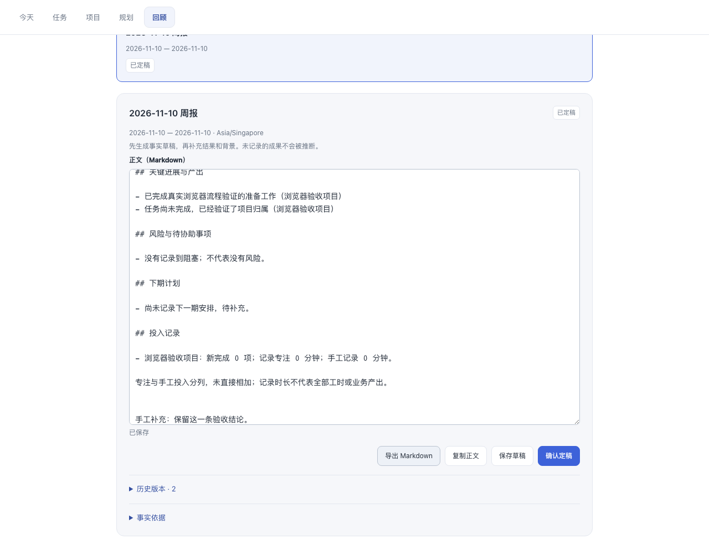
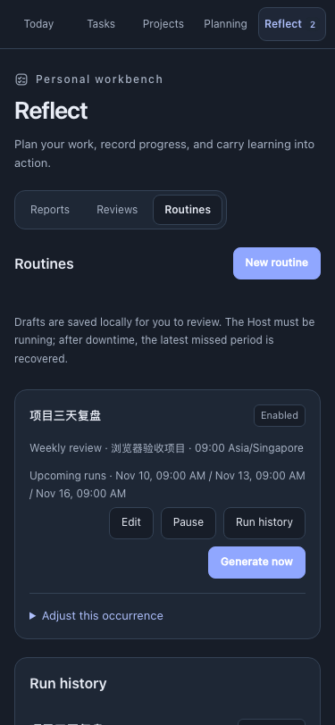

# 个人工作台 2.0 验收

日期：2026-11-10。结果：**75 项自动测试、17 项浏览器流程检查通过**。

## 检查范围

| 检查 | 结果与边界 |
| --- | --- |
| `npm test` | 75/75 通过，含构建产物一致性、旧任务能力与新业务测试 |
| 存储 | 旧 v2 文件不变；v3 迁移可重试；写入 / fsync / rename 失败回滚；损坏和未来版本拒写 |
| 并发 | 四进程写入保留任务与事件；存活 PID 的锁不因年龄被抢占 |
| 数据保留 | 1,000 条任务与 20,000 条事件样本不被截断；此项不是生产性能承诺 |
| 事实与范围 | 历史项目 / 标签归属，完成 / 重开 / 再完成，归档活动、未知完成时间、未完成进展 |
| 文档 | 人工正文与定稿保留，候选修订，范围不可变，旧版本恢复的 CAS，复盘内容隔离 |
| 周期 | 自然周 / 月、月末、跨年、显式时区、DST、每 3 天触发与滚动 7 天覆盖分别计算 |
| 自动化 | 重复触发去重，最近一期补偿，跳过 / 暂停 / 稍后，有限重试，单期失败不影响后续周期 |
| Host 组合 | 使用受控 Host 服务替身，验证 API 与七个工具共用数据、后台生命周期与卸载 |
| 包检查 | `npm pack --dry-run --json`，2.0.0 包含全部新增服务端模块、客户端产物和使用说明 |
| 差异检查 | `git diff --check` 通过 |

## 浏览器流程

Playwright 1.62.1 / Chromium，Node.js 22.22.3。使用真实 React、真实本地 HTTP 接口和临时 v3 文件；不会读取或修改用户的 DSH 数据。

1. 创建项目并回读持久化记录。
2. 保存未完成工作的项目进展。
3. 创建任务，设置项目与估时。
4. 为任务补充进展。
5. 确认日计划并检查初始承诺。
6. 今日视图出现计划任务。
7. 番茄钟开始、暂停、继续、提前结束，保存一条关联任务的专注记录。
8. 项目报告包含已记录的实际进展。
9. 人工补充并定稿，内容保存。
10. 导出 Markdown 与编辑后的正文一致。
11. 复盘改进行动成为真实任务。
12. 自定义周期预览接下来三次触发。
13. 保存规则的项目范围与间隔。
14. 立即执行规则并保存草稿。
15. 同周期重复执行不创建第二份文档。
16. 刷新后项目仍可读取。
17. 375px 英文深色 / 减少动效的五个视图无横向溢出，可用键盘聚焦。

浏览器未捕获到 JavaScript 页面异常。结构化检查结果见[浏览器结果](2026-11-10-workbench-browser.json)。

## 真实验证边界

未在当前运行的 DeepSeek Harness profile 安装新版或执行真实用户周期任务；没有对外发布报告。定时恢复使用可控制时间的自动测试，未连续等待多日；番茄钟浏览器检查为提前结束，未实际等待 25 分钟。既有 1.0 的 axe / 完整番茄钟验收不计入本轮新界面的结果。

本版本自动化由 Host 本地检查器执行，未接入 Harness Schedule → Agent 投递。Host 停止时不运行，重新启动只补最近一个遗漏周期。
